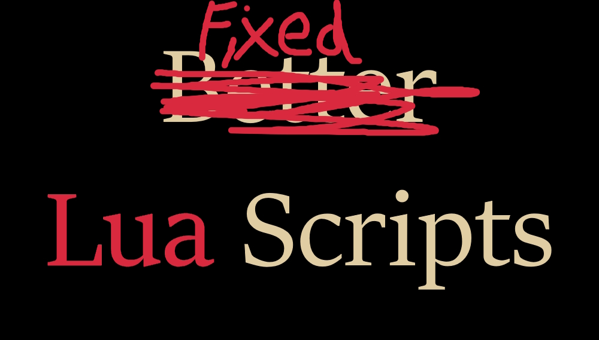

# DD2 LUA Mod Fixes
A collection of Dragon's Dogma 2 REFramework LUA mods that I fixed. Use at your own risk.

This collection of mods can also be found in [NexusMods](https://www.nexusmods.com/dragonsdogma2/mods/1723)

## Fixed Mods 

### [Shut Up Pawns](https://www.nexusmods.com/dragonsdogma2/mods/248) by [emoose](https://www.nexusmods.com/dragonsdogma2/users/1439296)
- Completely gutted the old ID system to use exact messages instead (IDs are no longer used in DD2)
- Fixed errors involving PopStyleColor() and TreePop()
- Fixed possible `nil` access values when it tries to obtain `app_MessageManager`
- It will now try to reobtain the `app_MessageManager` if it is never loaded
- Fixed presets always re-applying themselves when you had none selected
- Added option to completely silence your pawns. They should never speak again with this enabled.
- Added option to manually input your own blocklist entries (so "ingredient" will block any message that contains the word)

### [Hide Helmets Out of Combat](https://www.nexusmods.com/dragonsdogma2/mods/961) by [CriticalError](https://www.nexusmods.com/dragonsdogma2/users/76665613)
- Now checks if we are in combat every 15 frames instead of every frame, reducing performance impact.
- Fixed equipment errors and updated to latest REFramework method calls

### [Mark Important NPCs](https://www.nexusmods.com/dragonsdogma2/mods/433) by [mishapsi](https://www.nexusmods.com/dragonsdogma2/users/14594374)
- Fixed ImgGUI call errors
- Added new option to show an exclaimation (!) to mark important NPCs
- Added new config variables to customize its color and size
- Added new config variable to set how often the mod searches for important NPCs to reduce performance impact
- Added options to (properly) disable itself during cutscenes and while in menus

### [Carry It For Me](https://www.nexusmods.com/dragonsdogma2/mods/284) by [lingsamuel](https://www.nexusmods.com/dragonsdogma2/users/21480414)
- Updated to support Dark Arisen
- Now uses a fallback snapshot of the player's inventory to check what item was added should old methods fail
- Fixed GetItem calls to use the updated signatures
- GetItemOption.EventType is now being used instead
- Fixed a bug pertaining to event items never being filtered correctly
- Fixed equipment not being passed to pawns
- Now uses a proper round-robin distribution, spreading out the load until everyone else is full

### [EkiToolsBox](https://www.nexusmods.com/dragonsdogma2/mods/411) by [Ekibunnel](https://www.nexusmods.com/dragonsdogma2/users/4522098)
- Added unique IMGUI IDs to fix conflicts
- Fixed outdated references
- Fixed fur toggle that was also changing dragon forged opacity
- Fixed sliders incorrectly applying unless you are hovering over it
- Fix for having gaps in pawn party
- Fixed several possible cases nil-access bugs

### [Pawn Standby Disabler](https://www.nexusmods.com/dragonsdogma2/mods/680) by [Geonode](https://www.nexusmods.com/dragonsdogma2/users/6993355)
- Fixed crash on start. We no longer skip controller logic at start
- Fixed `app.PawnManager` usage
- Saved settings correctly to the json it is expecting instead of `pawn-sd.json.json`
- Removed `GuiManager.OnChangeScreenType` (loading screen) as its not needed
- Removed old commented code that never worked
- We no longer skip `update` methods as this was what was setting/clearing "Wait" commands (either from the player, on game load, or port crystal teleport)
- Added a "Release standby pawns" button in the options menu for times when pawns are locked in a standby state (like due to quests or cutscenes)

### [Slower Bow Aiming](https://www.nexusmods.com/dragonsdogma2/mods/879) by [rbwadle](https://www.nexusmods.com/dragonsdogma2/users/191391924)
- Fixed errors invloving `TreePop()`
- Now uses `app.PlayerInputProcessor.update()` to read bow and throw aim state once after user input
- Now uses `app.GuiManager.isPausedGUI()` to hide the aiming filter while paused.
- Fixed a mod conflict with any other mods that deal with `WorkRate`. Should the slowmo not be available, it will wait until it can do it instead of causing the script to fail.
- Added a hotkey to activate slowmo (defaults to L3 for controller) with options to tap or hold to activate. Pressing key again, leaving aim, or entering a menu will disable slowmo.
- Hotkey activation comes with a default delay of 0.25 seconds for taps. This is to make it compatible with mods that adds dodges and other double-tap commands.
- Because of above changes, this mod now requires [_ScriptCore](https://www.nexusmods.com/dragonsdogma2/mods/30)

### [ItemsHalfWeight](https://www.nexusmods.com/dragonsdogma2/mods/141) by [NekoNekoYukari](https://www.nexusmods.com/dragonsdogma2/users/130442123)
- Uses updated item enumerators
- Now waits for item data to be available instead of assuming it'd be available at boot
- Should the game rebuild its item details, this will reapply
- Restores changes after any manual script resets
- Item now rounds down to fit Int16 units that the game uses
- Added actual logs for success or failure
- Renamed the file to `ItemHalfWeight`.

## Working but Optimized Mods
These are mods that are working but have issues that irked me to hell.

### [Clock](https://www.nexusmods.com/dragonsdogma2/mods/150) by [xyzkljl1](https://www.nexusmods.com/dragonsdogma2/users/133617318)
This mod is technically working but by the brine does it eat up resources at high FPS. It accounts for 10% of the game's tick cycle alone! Now its more like 1%.

- Optimized the heck out of it.
- Got rid of seconds. It was never needed.
- We peg TimeManager every 0.5 second (4x per in-game minute) instead of every frame
- The display string is now cached. We only update once every in-game minute (2 seconds real world)
- Any changes to settings updates the cache immediately.
- Changing font size no longer requires a restart
- Added ability to disable the clock during cutscenes (tho what the game counts as cutscenes is spotty)
  - This check is done every 0.5 sec as it is costly otherwise
